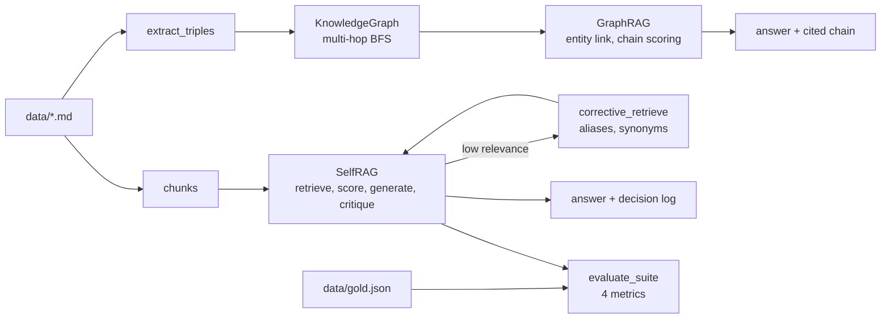

# Jagadish-agentic-rag

[](https://github.com/jagadishmazure-jpg/Jagadish-agentic-rag/actions/workflows/ci.yml)
[](https://github.com/jagadishmazure-jpg/Jagadish-agentic-rag/actions/workflows/codeql.yml)


**RAG beyond top-k chunks: a knowledge graph for multi-hop questions, a self-correcting retrieval loop with a grounding check, and RAGAS-style evaluation on a gold set. Deterministic and offline.**

> Personal learning and portfolio project. Everything runs offline on synthetic,
> fictional data with no API keys. Nothing is deployed. Numbers in this README
> come from real runs and are re-checked by CI (`scripts/render_docs.py --check`).

## Recruiter summary

- Implements three patterns that fix common RAG failures: GraphRAG for multi-hop answers, self-RAG/corrective retrieval, and evaluation with four metrics.
- Real run: a two-hop question is answered with its cited chain (NovaBot uses TitanArm, TitanArm costs $12,000); eval over 7 gold questions gives faithfulness 1.0, answer relevancy 0.845, context precision 1.0, context recall 0.929.
- Deterministic offline tests; CI with lint, CodeQL, gitleaks and documented-output drift checks.

## Purpose

Plain chunk-and-generate RAG fails in predictable ways: the answer spans two
documents, retrieval returns plausible but wrong context, and nobody measures
quality. This repo implements the standard fixes on a small fictional corpus
(Acme Robotics, 10 documents) with no model or network, so each step can be
inspected and tested. My notes are in [knowledge/](knowledge/README.md).

## Architecture



## How it works

**GraphRAG** (`agragr/graphrag.py`): link entities in the question, map words
to relation intents (gripper to `uses`, cost to `costs`), walk paths of up to two
hops and pick the chain that covers the most intents. The answer cites the chain.
With no linked entity or intent it falls back to keyword chunk retrieval.

**Self-RAG** (`agragr/selfrag.py`): retrieve by content-word overlap, score
relevance by question-term coverage, reformulate with aliases and synonyms when
below threshold (at most 3 iterations), generate extractively, then reject any
sentence not supported by a retrieved chunk. Every decision is logged.

**Eval** (`agragr/eval.py`): faithfulness, answer relevancy, context precision
and context recall over `data/gold.json`. More detail:
[docs/rag-patterns.md](docs/rag-patterns.md), [knowledge/01-concepts.md](knowledge/01-concepts.md).

## Real code and output

```python
"""GraphRAG multi-hop answer, a self-RAG run with its decision log, and the eval suite."""
from pathlib import Path

from agragr import Chunk, GraphRAG, KnowledgeGraph, SelfRAG, evaluate_suite, extract_triples

data = Path(__file__).resolve().parent.parent / "data"
texts = {p.stem: p.read_text() for p in sorted(data.glob("doc-*.md"))}

graph = KnowledgeGraph()
for text in texts.values():
    graph.add_triples(extract_triples(text))
print(f"Graph: {len(graph.entities)} entities, {graph.triple_count} triples from {len(texts)} documents")

rag = GraphRAG(graph, texts)
ans = rag.answer("What gripper does NovaBot use and how much does it cost?")
print("GraphRAG answer:", ans.answer)
print("Evidence chain:", ans.evidence)

self_rag = SelfRAG([Chunk(id=c, text=t) for c, t in texts.items()])
res = self_rag.answer("What is the battery life of NovaBot?")
print("Self-RAG answer:", res.answer)
print("Grounded:", res.grounded, "| iterations:", res.iterations)
for entry in res.log:
    print("  log:", entry.iteration, entry.action, entry.detail)

report = evaluate_suite(self_rag.answer, data)
print("Eval over gold set:", {k: round(v, 3) for k, v in report.means.items()})
```

Output of `python examples/demo.py` (real run, re-checked in CI):

<!-- run: python examples/demo.py -->
```text
Graph: 22 entities, 28 triples from 10 documents
GraphRAG answer: $12,000 (NovaBot -> uses -> TitanArm -> costs -> $12,000).
Evidence chain: ['NovaBot --uses--> TitanArm', 'TitanArm --costs--> $12,000']
Self-RAG answer: # NovaBot specifications

NovaBot has a battery life of 18 hours. NovaBot can carry a payload of 500 kilograms.
Grounded: True | iterations: 1
  log: 1 retrieve query='What is the battery life of NovaBot?' -> ['doc-07-novabot-specs', 'doc-01-novabot-overview']
  log: 1 score_relevance 1.00
  log: 1 generate answer='# NovaBot specifications

NovaBot has a battery life of 18 hours. NovaBot can ca'
  log: 1 critique_grounding grounded=True; unsupported=[]
Eval over gold set: {'faithfulness': 1.0, 'answer_relevancy': 0.845, 'context_precision': 1.0, 'context_recall': 0.929}
```
<!-- /run -->

## How to run

```bash
git clone https://github.com/jagadishmazure-jpg/Jagadish-agentic-rag.git
cd Jagadish-agentic-rag
python -m pip install pytest      # no runtime dependencies
python -m pytest -q          # offline, no keys
python examples/demo.py
python scripts/render_docs.py --check   # documented output still matches
```

Test suite size (real collection, re-checked in CI):

<!-- run: python scripts/count_tests.py -->
```text
29 tests collected
```
<!-- /run -->

## Guardrails

- Grounding critique: answer sentences without token support in retrieved chunks are rejected.
- Bounded corrective loop (3 iterations), with the full decision log returned.
- GraphRAG answers cite the entity-relation chain they used.
- Fallback to chunk retrieval instead of guessing when the graph has no coverage.

## Limitations

- Extraction is regex and gazetteer based; it only works on this corpus's sentence shapes.
- Retrieval is keyword overlap, not embeddings.
- Generation is extractive and can include a document heading in the answer (visible in the run above).
- The gold set has only 7 questions, and the metrics are deterministic token-overlap scores I wrote, not LLM judges; treat the numbers as regression checks, not quality claims.

## Built vs planned

| Capability | Status | Where |
|---|---|---|
| Triple extraction and knowledge graph | Built | `agragr/extract.py`, `agragr/graph.py` |
| Multi-hop GraphRAG with cited chains | Built | `agragr/graphrag.py` |
| Self-RAG / corrective loop | Built | `agragr/selfrag.py` |
| Four-metric eval harness | Built | `agragr/eval.py` |
| Embeddings, vector store, LLM generation | Planned | docs/implementation-guide.md |
| LLM-judge or NLI grounding | Planned | not started |

## Implementation guide

The step-by-step path from this offline build to an Azure deployment is in
[docs/implementation-guide.md](docs/implementation-guide.md). None of it has been
run; it is a plan.

## Related repositories

| Repo | How it relates |
|---|---|
| [Jagadish-llm-evals-observability](https://github.com/jagadishmazure-jpg/Jagadish-llm-evals-observability) | Broader eval and tracing harness |
| [Jagadish-agentic-data-layer](https://github.com/jagadishmazure-jpg/Jagadish-agentic-data-layer) | Retrieval over governed enterprise data |
| [Jagadish-document-intelligence](https://github.com/jagadishmazure-jpg/Jagadish-document-intelligence) | Getting structured facts out of documents |
| [Jagadish-langchain-langgraph-langsmith](https://github.com/jagadishmazure-jpg/Jagadish-langchain-langgraph-langsmith) | The same ideas in framework form |

## Documentation

- [RAG patterns](docs/rag-patterns.md)
- [Concepts](knowledge/01-concepts.md)
- [Architecture diagrams](knowledge/02-architecture.md)
- [Implementation guide (Azure)](docs/implementation-guide.md)
- [Interview points](docs/interview-points.md)
- [Security policy](SECURITY.md)

## Project layout

```
agragr/
  extract.py   entity and relation extraction
  graph.py     knowledge graph, multi-hop BFS
  graphrag.py  entity linking, chain scoring, cited answers
  selfrag.py   retrieve, score, generate, critique loop
  eval.py      four metrics + suite runner
data/          fictional corpus + gold.json
examples/demo.py  the run shown above
tests/         offline pytest suite
```

## License

MIT, see [LICENSE](LICENSE). All data is synthetic; every organisation and person is fictional.
